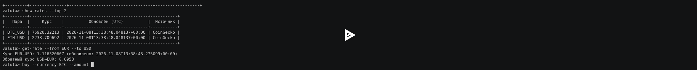

# ValutaTrade Hub

Консольное приложение для отслеживания курсов валют
и симуляции покупки и продажи валют.

Автор: Гончаров Иван Дмитриевич, группа M26-555.

## Возможности

- Регистрация и вход по имени и паролю.
- Кошельки USD, EUR, GBP, RUB, BTC, ETH и SOL.
- Покупка, продажа и оценка портфеля в выбранной валюте.
- Прямые, обратные и кросс-курсы через USD.
- Получение курсов через CoinGecko и ExchangeRate-API.
- История курсов, проверка свежести и кэширование расчётов.
- Журналы операций с ротацией файлов.
- Отдельный планировщик обновления курсов.

## Модель торговли

Используется упрощённая модель, разрешённая условиями проекта:
buy увеличивает баланс выбранной валюты, sell уменьшает его.
USD при этом не списывается и не начисляется.

Стоимость покупки или продажи в USD показывается справочно.
Продажа при недостаточном балансе запрещена.
Начальный портфель нового пользователя пустой.

Приложение является учебной симуляцией и не выполняет реальные сделки.

## Установка и запуск

Нужны uv и Python 3.12 или новее.

В корневой папке проекта:

```shell
uv sync --locked
uv run project
```

Альтернативные команды при установленном GNU Make:

```shell
make install
make run
```

В Windows, если Make установлен через GnuWin32,
но не найден в текущем PowerShell:

```powershell
$env:Path = "C:\Program Files (x86)\GnuWin32\bin;" + $env:Path
```

## Ключи API

Для ExchangeRate-API нужен ключ из личного кабинета
https://www.exchangerate-api.com/.

Перед запуском приложения задайте его в PowerShell:

```powershell
$apiSecret = Read-Host "Ключ ExchangeRate-API" -AsSecureString
$env:EXCHANGERATE_API_KEY = [System.Net.NetworkCredential]::new("", $apiSecret).Password
Remove-Variable apiSecret
uv run project
```

Переменная действует в текущем терминале и наследуется приложением.
После закрытия терминала её нужно задать заново.

Для CoinGecko при необходимости используется переменная
COINGECKO_API_KEY с ключом Demo API.

Ключи не записываются в исходный код.
Файлы .env исключены из Git; автоматическое чтение .env не реализовано.

## Команды приложения

Следующие команды вводятся внутри приложения, после приглашения valuta>:

```text
register --username alice --password example-password
login --username alice --password example-password
update-rates
show-rates
show-rates --currency BTC
show-rates --top 2
buy --currency BTC --amount 0.001
show-portfolio
show-portfolio --base EUR
get-rate --from BTC --to EUR
sell --currency BTC --amount 0.0005
logout
exit
```

Выбор отдельного источника:

```text
update-rates --source coingecko
update-rates --source exchangerate
```

Справка:

```text
help
buy --help
```

Имена пользователей чувствительны к регистру.
Коды валют нормализуются в верхний регистр.
Количество валюты должно быть положительным конечным числом.
Покупка, продажа и личный портфель требуют входа.

Регистрация не выполняет вход автоматически.
Успешный повторный login заменяет текущую сессию.
Неудачный login сохраняет прежнюю сессию.
После закрытия приложения сессия не сохраняется.

Параметр show-rates --top выбирает самые дорогие
криптовалюты по цене одной единицы в USD, исключая фиатные валюты.

## Курсы, свежесть и история

Текущие курсы хранятся в data/rates.json:

```json
{
  "pairs": {
    "EUR_USD": {
      "rate": 1.25,
      "updated_at": "2026-11-08T12:00:00+00:00",
      "source": "ExchangeRate-API"
    }
  },
  "last_refresh": "2026-11-08T12:00:00+00:00"
}
```

Числа в примере учебные.

Направление EUR_USD означает стоимость одного EUR в USD.
Ответ ExchangeRate-API от USD обращается без предварительного округления.
Кросс-курсы рассчитываются через USD; округляется только вывод.

updated_at обозначает время получения и проверки ответа приложением.
Срок свежести проверяется для каждой используемой пары отдельно.
По умолчанию он равен 300 секундам.
Устаревший курс запрещает расчёт и торговлю:
пользователю предлагается выполнить update-rates.

show-rates показывает сохранённые курсы вместе с датами,
включая устаревшие записи.

Замыкание кэширует числовые расчёты курсов.
Проверка свежести выполняется до обращения к кэшу.
Изменение исходных курсов меняет ключ кэширования.

История измерений хранится в data/exchange_rates.json.
Повторные измерения с одинаковым идентификатором не дублируются.
Более старое измерение не заменяет новый текущий курс.

При отказе одного источника сохраняются результаты другого,
а прежние курсы недоступного источника остаются со старыми датами.
При отказе всех источников снимок и история не изменяются.

## Настройки

Конфигурация находится в секции [tool.valutatrade] файла pyproject.toml:

- data_dir — папка данных;
- logs_dir — папка журналов;
- rates_ttl_seconds — срок свежести курсов;
- default_base_currency — базовая валюта портфеля;
- request_timeout — тайм-аут HTTP-запроса;
- update_interval_seconds — пауза между обновлениями планировщика.

Без конфигурационного файла используются значения по умолчанию.
Относительные пути считаются от текущей рабочей папки.

## Планировщик

Запускается отдельно от интерактивного приложения:

```shell
uv run python -m valutatrade_hub.parser_service.scheduler
```

Однократное обновление:

```shell
uv run python -m valutatrade_hub.parser_service.scheduler --once
```

Можно добавить --source coingecko или --source exchangerate.
Остановка постоянного режима — Ctrl+C.

Не запускайте обновления планировщика и CLI одновременно
для одной папки данных: межпроцессная блокировка не реализована.

## Архитектура

```text
main.py
valutatrade_hub/
    core/
        models.py
        currencies.py
        exceptions.py
        usecases.py
        utils.py
    infra/
        settings.py
        database.py
    parser_service/
        config.py
        api_clients.py
        storage.py
        updater.py
        scheduler.py
    cli/
        interface.py
    decorators.py
    logging_config.py
tests/
data/
```

Модели не читают JSON и не выполняют сетевые запросы.
TradingService объединяет модели и хранилище.
CLI разбирает команды, хранит сессию и выводит результаты.
SettingsLoader и DatabaseManager реализованы как Singleton.

Пароли хранятся как PBKDF2-HMAC-SHA256 с индивидуальной случайной солью
и 200 000 итераций. Исходный пароль не сохраняется.
Выбор PBKDF2 усложняет перебор по сравнению с однократным SHA-256.

Запись JSON выполняется через временный файл и os.replace.
Каждый файл заменяется отдельно; общей транзакции нескольких файлов нет.
Повреждённый JSON не заменяется пустыми данными автоматически.

## Журналы

- logs/actions.log — BUY и SELL, успешные и неудачные операции;
- logs/parser.log — обновления и ошибки источников.

Декоратор log_action сохраняет сведения об операции
и передаёт исключения вызывающему коду.
Для успешной торговли записываются балансы до и после операции.

Формат строки: время, уровень и сообщение.
Сообщения торговых операций содержат JSON с timestamp в UTC.
Ротация: 1 МиБ на файл, до трёх резервных копий.
Папка logs исключена из Git.

## Проверки и сборка

```shell
make check
make build
```

Эквивалентные команды без Make:

```shell
uv run ruff check .
uv run ruff format --check .
uv run python -m unittest discover -s tests -v
uv build
```

Проверка оформления собранных пакетов:

```shell
uvx twine check dist/*
```

Автоматические тесты не требуют сети или настоящих ключей API.
Они проверяют модели, торговлю, свежесть курсов,
преобразование ответов, отказы источников и сохранность файлов.

Сборка создаёт wheel и архив исходников в dist/.
Публикация на PyPI не требуется.

## Демонстрация

Запись показывает регистрацию, вход, обновление курсов,
покупку и продажу, оценку портфеля и обработку ошибок.

[](https://asciinema.org/a/HioLdzCzeqM5QR0R)

[Открыть запись на asciinema](https://asciinema.org/a/HioLdzCzeqM5QR0R).

Локальные файлы записей .cast исключены из Git.